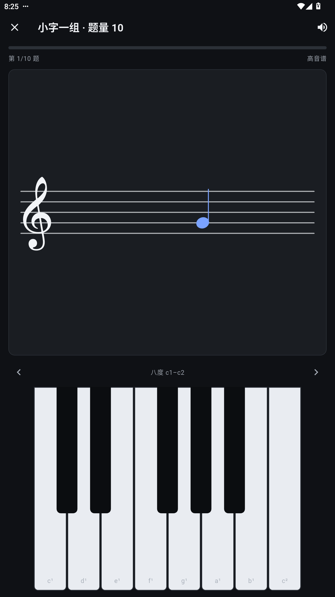
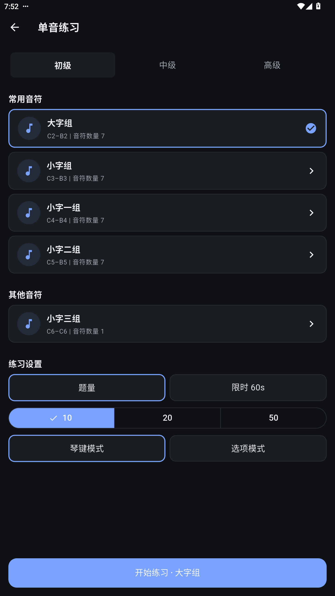
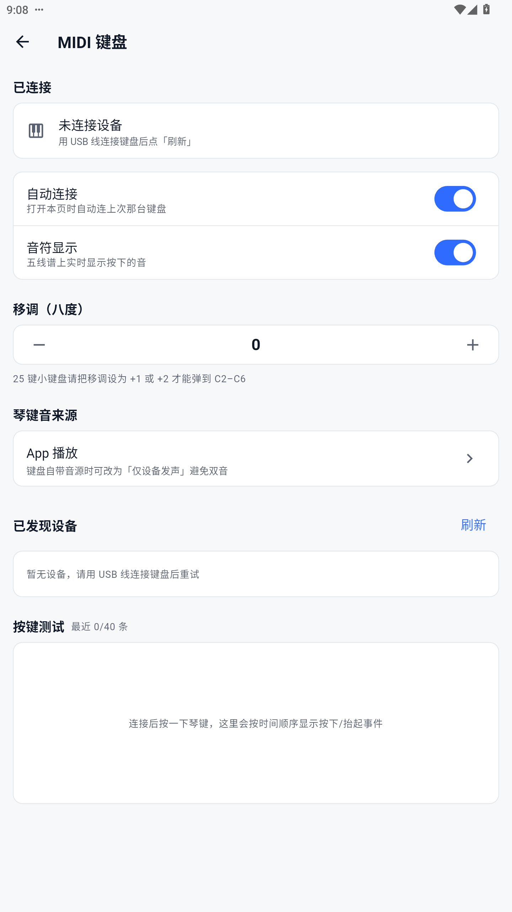

# 音符卡 NoteCard

> **本项目仅供开发者个人学习自用，非商业产品。**
> 用于练习五线谱音符识别的 Android 应用，参考了「口袋五线谱」的单音练习交互思路，但**代码、素材、文案全部为本项目自行实现**，不含任何参考 App 的资源。
> 请勿用于商业分发；学习者可自由 fork 与改造，但由此产生的任何问题与作者无关。

屏幕上一行五线谱、一个音符，你在下面的键盘（触屏或真实 MIDI 键盘）上点出它是谁。

- 仅 Android（minSdk 26 / Android 8.0+），竖屏，完全离线，无账号，不声明网络权限
- 52 个自然音（A0–C8，88 键钢琴的全部白键）
- 支持 USB / 蓝牙 MIDI 键盘输入，可自动重连上次那台琴
- 数据只存在本机 SQLite，卸载即清空

## 界面

| 练习（键盘作答） | 难度分组 | MIDI 设备 |
| --- | --- | --- |
|  |  |  |

## 功能

**练习**
- 三种难度：初级按八度分组（9 组）、中级按音区与谱表位置（6 组）、高级全音区（52 音）
- 两种模式：题量（10 / 20 / 50 题）、限时 60 秒
- 两种作答：屏幕琴键 / 六选一
- 三态反馈：答对绿、答错红（错音立刻响一次）、超时走完
- 8 度键盘自动翻到当前音所在八度（可关）

**MIDI 键盘**
- USB 与蓝牙 MIDI 输入，插拔即时感知
- 自动连接上次那台设备（按「传输方式 + 名称」识别，Android 每次插拔都会换设备 id）
- 按键测试框：实时显示 `时:分:秒.毫秒 · 按下/抬起 · 音名 · 力度`
- 「我的设备」：历史设备列表，可连接 / 查看信息 / 删除
- 五线谱上实时显示按下的音（空心符头，可关）
- 25 键小键盘可用移调（−2…+2 个八度）补齐音域

**其它**
- 错题本、统计（今日题量 / 正确率 / 平均反应 / 连续天数、近 7 天分布、各难度正确率、Top5 错音）
- 音名记法可切换：中国科学音高记号法（默认，中央 C = `c¹`）/ 国际记法（`C4`）
- 音名 / 唱名（`C-D-E` / `do-re-mi`）切换
- 深色 / 浅色 / 跟随系统
- 音效（Salamander 钢琴采样，30 个采样点覆盖 A0–C8）、震动、TalkBack 语义

## 技术栈

| 层 | 选型 |
| --- | --- |
| UI | Flutter 3.50 / Material 3，Riverpod 3 状态管理 |
| 路由 | go_router（StatefulShellRoute，4 个 Tab） |
| 存储 | drift + sqlite3（本机三表：practice_session / answer_record / wrong_note） |
| 设置 | shared_preferences（JSON 序列化） |
| MIDI | flutter_midi_command |
| 音频 | flutter_soloud（固定 4.x，5.x 的 Dart build hook 需要 MSVC） |
| 谱面 | 自绘 CustomPainter + Bravura（SMuFL）字体 |

## 目录

```
lib/
  app.dart                 应用壳、启动即扫描 MIDI
  router/                  路由与 URL 解析（?group=&mode=&count=&input=）
  core/
    constants/             音高映射、分组目录、音名记法
    theme/                 颜色 token、间距、动效
    providers.dart         所有 Riverpod provider
  data/
    db/                    drift 数据库与查询
    repositories/          会话 / 统计 / 错题
    audio/                 SoLoud 播放与变速补音
    midi/                  MIDI 服务、去抖、掉线检测
    prefs/                 设置读写
  domain/                  会话模型、出题器
  features/                home / practice / result / wrong_book / statistics / settings / midi
docs/
  制作文档.md               完整设计与实现文档（2480+ 行）
  screenshot-*.png
```

## 本地运行

需要 Flutter 3.50+、JDK 17、Android SDK 36：

```bash
flutter pub get
flutter analyze
flutter test
flutter run                      # 接真机或模拟器
flutter build apk --release --split-per-abi
```

Windows 上如果路径含中文，建议把 `PUB_CACHE` 指到纯英文目录并设置 `JAVA_TOOL_OPTIONS=-Dfile.encoding=UTF-8`，否则 Gradle 的 CMake 配置会因 JSON 编码损坏而失败（详见 `docs/制作文档.md` 附录 C）。

## 数据与隐私

- 不上传任何数据，App 不声明网络权限
- 练习记录、错题、设置全部保存在本机
- 卸载 App 即全部清除

## 素材与许可

| 素材 | 来源 | 许可 |
| --- | --- | --- |
| Bravura 乐谱字体 | [Steinberg SMuFL](https://www.smufl.org/) | SIL Open Font License 1.1 |
| 钢琴采样 | [tonejs/Salamander](https://github.com/tonejs/audio) | CC BY 3.0（已降采样为 mp3，仅用于本 App 发声） |

代码与文案版权归本仓库作者所有；如用于学习以外的用途，请自行确认素材许可链。

## 声明

- 本项目是**个人学习 Flutter / 乐理可视化 / MIDI 集成**的练手作品，非商业项目，不提供任何形式的担保。
- 不包含参考 App 的任何代码、图标、文案或音频素材。
- 若你也在学五线谱，欢迎自取；若用于商业场景，请自行承担合规责任。
